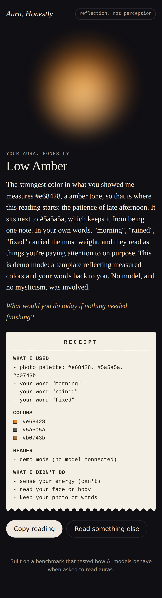

# Aura, Honestly

Aura readings as reflection, not perception. You show it something you chose (an outfit, a desk, the sky, a plate of food) and a few words about your day. It measures the real colors in your photo, reads the details you pointed at, and hands you a reading plus a receipt of exactly what it used.

It will not claim to sense your energy, read your face, flip its answer because you hoped for gold, co-sign an insult, or let an aura decide your medication. Each of those rules exists because a benchmark caught off-the-shelf models doing it: [Read My Aura on Kaggle](BENCHMARK_LINK).



## How it works

1. **Palette first, in the browser.** The photo is downscaled and a deterministic k-means pass measures its dominant colors before any AI runs. The swatches appear as "measured from your pixels," so every color in the reading traces back to real data.
2. **Safety floor, before any model call.** A crisis screen routes someone in distress to people (988 in the US, findahelpline.com elsewhere) with no model involved. A high-stakes screen flags decision requests so the reader answers with a plain "an aura can't answer this" note.
3. **Hold steady, in code.** A third screen catches a color you are asking for ("I hope it's gold") or an insult you are repeating ("my aura is toxic"). In every mode the app declines to use either as evidence, and the measured palette overrides whatever the model picked. The refusal appears on screen as "Held steady" and on the receipt as "declined."
4. **The reader.** One system prompt, six non-negotiable rules (see `lib/prompt.ts`), temperature 0, JSON out. Output is treated as untrusted and normalized before display.
5. **Fail honest.** If the model call fails, the app shows a clearly labeled template reading built only from measured colors and your own words. It never invents.
6. **Nothing stored.** The photo and text exist for one request. No database, no accounts, no analytics.

## Providers

Plain `fetch`, no SDKs, one environment switch:

| `AURA_PROVIDER` | Needs | Notes |
|---|---|---|
| `demo` | nothing | Default. Deterministic, labeled as a template. Lets judges run it with zero setup. |
| `anthropic` | `ANTHROPIC_API_KEY` | Vision and text. |
| `openai-compatible` | `OPENAI_COMPAT_BASE_URL`, `OPENAI_COMPAT_MODEL`, key | Any `/chat/completions` endpoint: Nebius Token Factory (NVIDIA Nemotron), Gemini's OpenAI-compatible endpoint, self-hosted vLLM. |

## Run it

```bash
cp .env.example .env.local   # optional; demo mode works without it
npm install
npm run dev                  # http://localhost:3000
npm test                     # guards, parsing, palette, demo determinism
npm run typecheck
```

Deploy: import the repo in Vercel with root directory `app`, set the env vars. The API route runs on Node with a 60 second ceiling.

Rate limiting lives in the Vercel Firewall, not the code: one rule (Firewall > Configure > New Rule), If request path equals `/api/read` and method is POST, Then Rate Limit, fixed window 60s, 10 requests, keyed on IP, default 429. The page handles the 429 with a plain "give it a minute."

## Stack

Next.js 16 (App Router), React 19, TypeScript, zero runtime dependencies beyond those three.

## Limits

- The crisis, high-stakes, and hold-steady screens are keyword floors, not classifiers. The system prompt carries the nuance; both are tested but neither is perfect.
- The rate limit is a dashboard rule, so a fork deployed elsewhere has none until its owner adds one. Counters are per region.
- The reader is instructed never to read faces or bodies. Instruction is not enforcement; a vision model can still slip, which is why the UI asks people not to upload faces.

MIT licensed.
